# Track-a-Demic

A web-based capstone and research topic management system for students and advisers.

## Description

Track-a-Demic replaces scattered chats, spreadsheets, and paper forms with one place to manage capstone work. Advisers create groups and set milestones and deadlines. Student groups submit topic proposals, log milestones and adviser meetings, save references, and upload drafts. Advisers review topics, comment, and monitor progress.

This project is the final requirement for Web Systems Technology.

## Features

- User registration, login, logout, and session management
- Two user roles with server-side access control: **Student** and **Adviser**
- Adviser tools: create groups, set milestones and deadlines, review and comment
- Student tools: topic proposals, milestone tracking, meeting logs, references, file uploads
- Topic status flow: Proposed, Approved, In Progress, Defended (or For Revision / Rejected)
- Similar-topic check on new proposals
- Dashboard charts, in-system notifications, dark/light mode
- Installable Progressive Web App
- Responsive layout for desktop (1366x768), tablet (768x1024), and mobile (375x667)

## Screenshots

Taken from the running system with the sample data. Desktop is 1366x768, tablet is 768x1024, and mobile is 375x667.

### Sign in and register

| Sign in | Register |
|---|---|
| 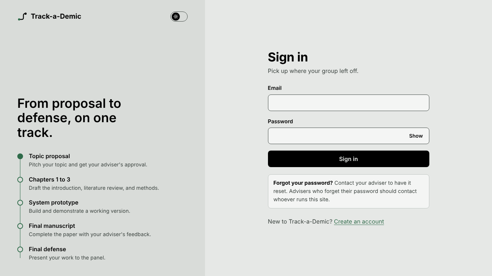 | 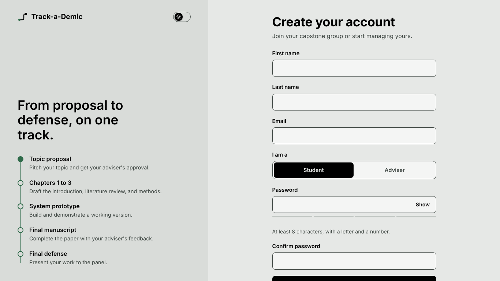 |

### Student

| Dashboard (topic, group, progress chart, milestones) | Milestones |
|---|---|
| 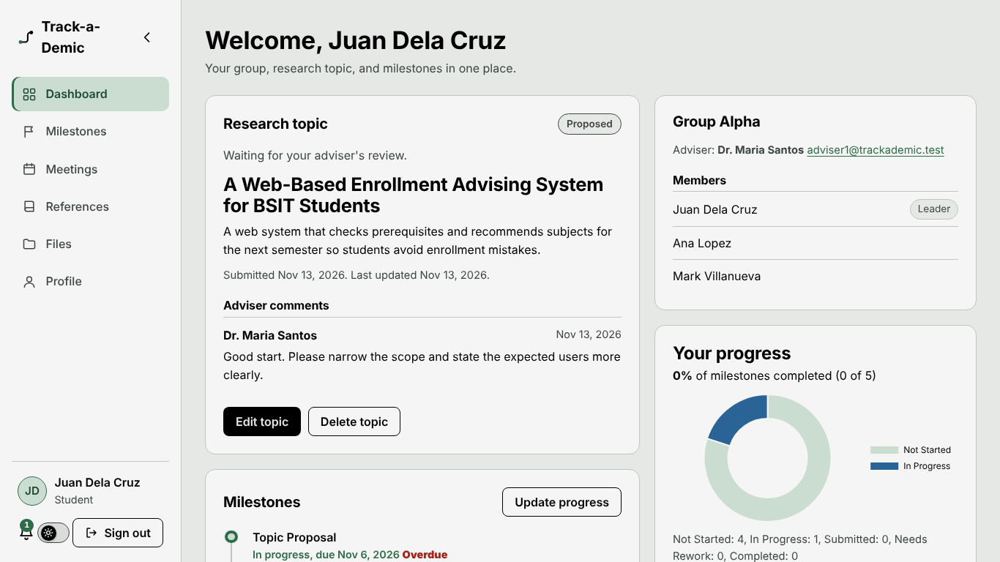 | 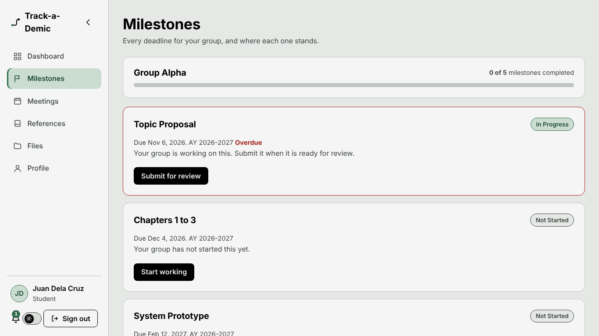 |

| Meetings (requests and shared logs) | Profile (30-day lock) |
|---|---|
| 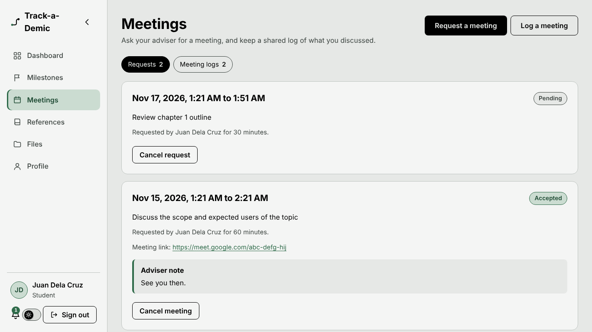 | 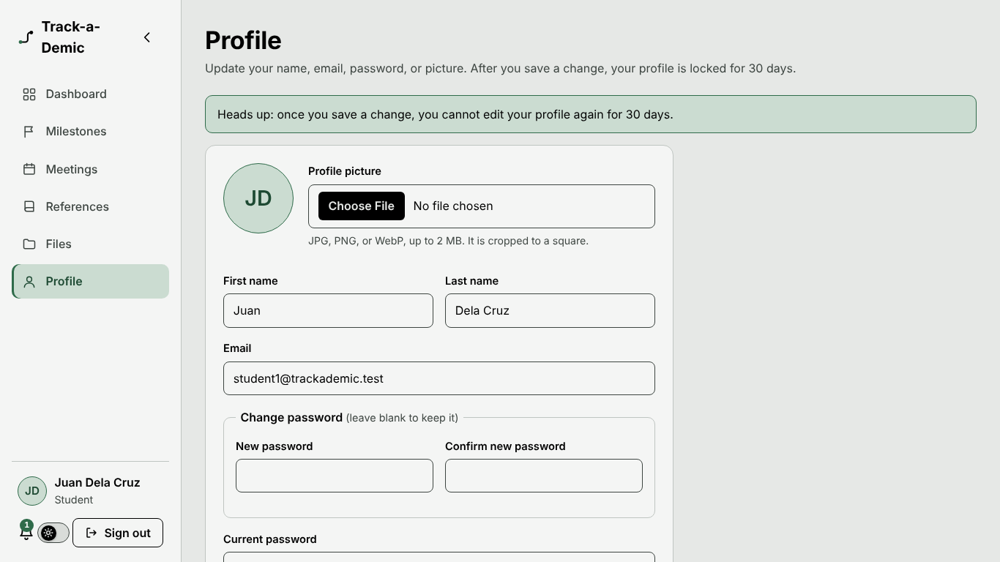 |

### Adviser

| Dashboard (topics by status, progress per group) | Topic reviews (similar-topic warning) |
|---|---|
| 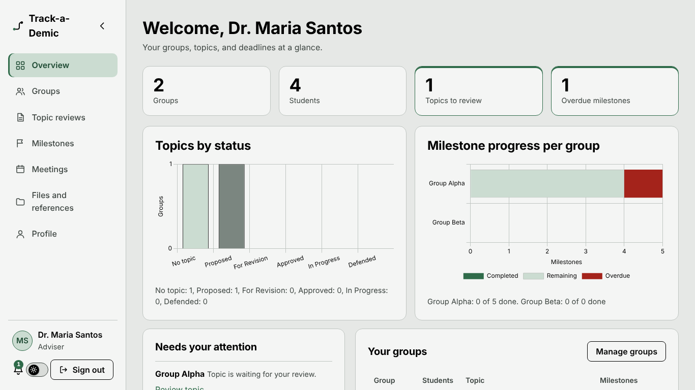 | 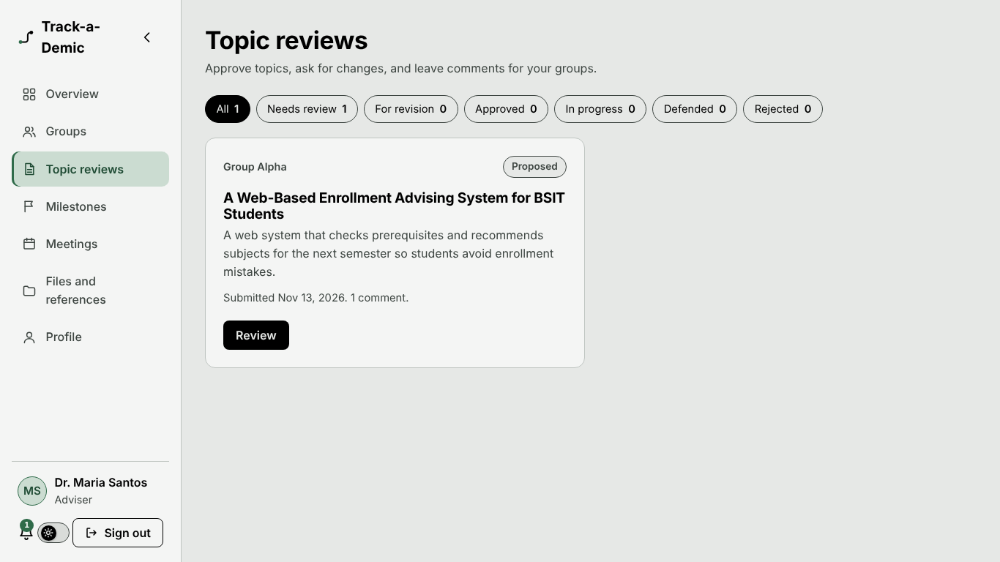 |

| Meetings (accept or reject requests) | Dark mode |
|---|---|
| 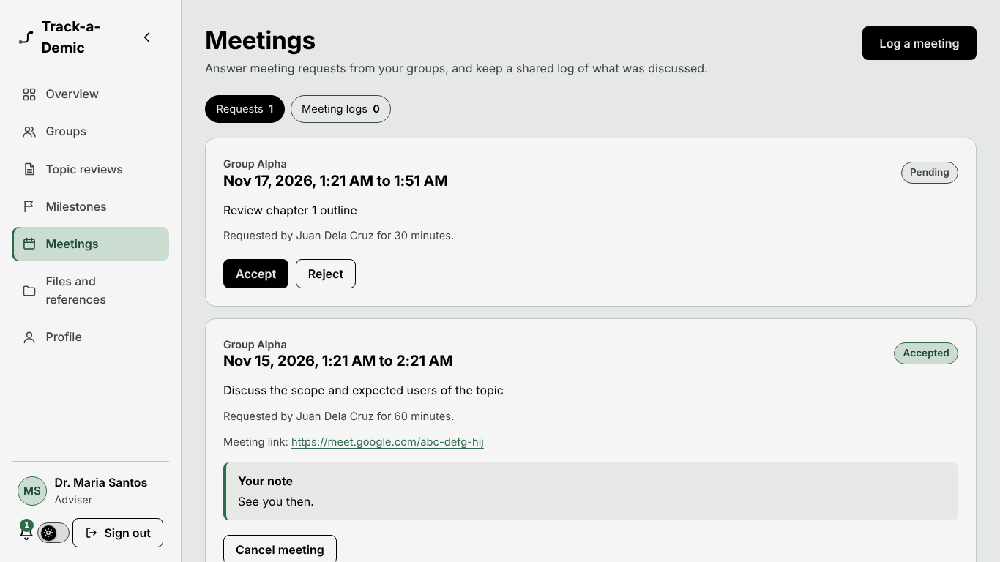 | 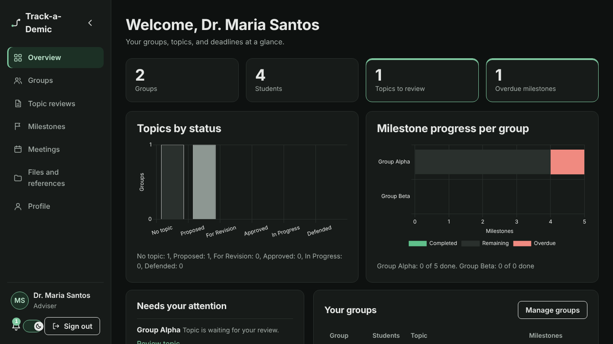 |

### Responsive layout

| Tablet (768x1024) | Mobile (375x667) |
|---|---|
| 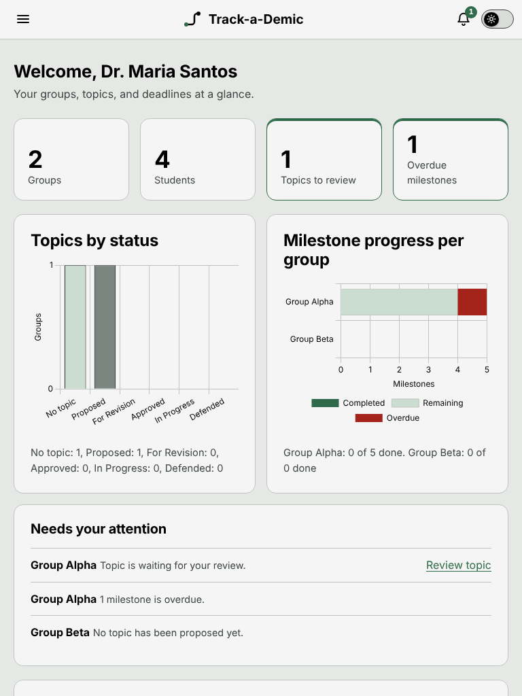 | 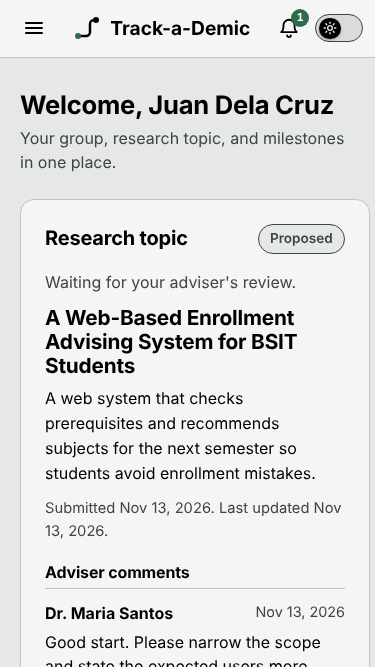 |

## Technologies

- HTML5, CSS3, JavaScript (ES6+)
- Fetch API (JSON requests to the PHP backend)
- PHP 8 with PDO
- MySQL / MariaDB
- Chart.js
- Git and GitHub
- Hosting: InfinityFree

## Project Structure

```
track-a-demic/
├── api/          PHP endpoints that return JSON (called with fetch)
├── assets/       CSS, JavaScript, and images
├── config/       Configuration template (config.php is not committed)
├── database/     schema.sql and seed.sql
├── docs/         Diagrams (architecture, ERD, use case, flowcharts) and screenshots
├── includes/     Shared PHP code (database, auth helpers, page layout)
├── pages/        Student and adviser pages
├── uploads/      Uploaded files (not committed)
└── index.php     Landing page
```

## Running the Project Locally

Requirements: [XAMPP](https://www.apachefriends.org/) (Apache, PHP 8+, MySQL/MariaDB) and Git.

1. Clone the repository into the XAMPP web folder:
   ```
   cd C:\xampp\htdocs
   git clone https://github.com/kenyakino/track-a-demic.git
   ```
2. Open the XAMPP Control Panel and start **Apache** and **MySQL**.
3. Create the configuration file: copy `config/config.example.php` to `config/config.php`. Set your database name, user, and password, and change `adviser_code` to your own secret (see [Authentication](#authentication)).
4. Set up the database (see below).
5. Open `http://localhost/track-a-demic/` in your browser.
6. To confirm the database connection works, open `http://localhost/track-a-demic/api/health.php`. It should show `{"ok":true,"database":"connected"}`.

## Creating and Importing the Database

1. Open phpMyAdmin at `http://localhost/phpmyadmin`.
2. Click **New** and create a database named `track_a_demic` with collation `utf8mb4_general_ci`.
3. Select the new database, open the **Import** tab, and choose `database/schema.sql`. Click **Import**.
4. (Optional) Import `database/seed.sql` to load sample accounts and data.
5. Make sure the values in `config/config.php` match the database you created.

### Sample accounts

If you imported `seed.sql`, you can log in with these accounts. All of them use the password `Password123!`.

| Role | Email |
|---|---|
| Adviser | adviser1@trackademic.test |
| Adviser | adviser2@trackademic.test |
| Student | student1@trackademic.test |
| Student | student2@trackademic.test |
| Student | student3@trackademic.test |
| Student | student4@trackademic.test |

The sample data is for development and demos only. Do not import `seed.sql` on a live site.

### Database tables

| Table | Purpose |
|---|---|
| users | Student and adviser accounts |
| capstone_groups | Groups created by advisers |
| group_members | Students in each group |
| topics | Topic proposals and their status |
| milestone_templates | Milestones and deadlines set by an adviser |
| group_milestones | Each group's progress on each milestone |
| meetings | Adviser meeting logs |
| comments | Feedback on topics, milestones, and files |
| references_list | Saved references |
| files | Uploaded drafts and documents |
| notifications | In-system alerts |
| meeting_requests | Meeting requests and their decisions |

### Updating an existing database

Fresh installs use `schema.sql` and already have everything. If you created your database earlier, run the files in `database/migrations/` once, in order, in phpMyAdmin (select the database, open **SQL**, paste the file, and click **Go**).

| Migration | What it adds |
|---|---|
| `001-file-sources.sql` | Where each file came from (`source_type`, `topic_id` on the `files` table) |
| `002-user-title.sql` | Academic title for advisers (`title` on the `users` table) |
| `003-profile.sql` | First and last name, profile picture, and the 30-day profile lock |
| `004-meetings.sql` | Meeting requests, and authors on meeting logs |

## Authentication

- Passwords are hashed with PHP's `password_hash()` and checked with `password_verify()`. Plain-text passwords are never stored.
- Sessions use an HttpOnly, SameSite cookie, and the session id is renewed at login.
- Every POST request to the API must send a CSRF token (the pages add it automatically).
- Repeated wrong passwords temporarily lock sign-in for that browser session.
- Pages and API endpoints check the user's role on the server. A student cannot open adviser pages, and the other way around.

**Roles:** anyone can register as a **Student**. To register as an **Adviser**, the person must enter the adviser code. Set it in `config/config.php`:

```php
'auth' => [
    'adviser_code' => 'your-own-secret-code',
],
```

Share the code only with advisers. The default placeholder code is rejected when `env` is set to `production`. After 5 wrong codes, adviser sign-up is locked for 5 minutes for that browser session.

| Page or endpoint | Purpose |
|---|---|
| `pages/login.php` | Sign in |
| `pages/register.php` | Create an account |
| `pages/student/dashboard.php` | Student dashboard (students only) |
| `pages/adviser/dashboard.php` | Adviser dashboard (advisers only) |
| `api/register.php` | Create an account |
| `api/login.php` | Sign in |
| `api/logout.php` | Sign out |
| `api/me.php` | Current signed-in user |
| `api/student-overview.php` | Student's group, topic, and milestones (GET) |
| `api/topic-create.php` | Propose a topic with its proposal file (POST, multipart) |
| `api/topic-update.php` | Edit a topic and send it back for review, with a new file when required (POST, multipart) |
| `api/topic-delete.php` | Delete a topic (POST, group leader only) |
| `api/adviser-overview.php` | Adviser's totals, attention list, and groups (GET) |
| `api/adviser-groups.php` | Adviser's groups with members, plus students without a group (GET) |
| `api/adviser-topics.php` | Topics of the adviser's groups with comments (GET) |
| `api/group-create.php` | Create a group, optionally with students (POST) |
| `api/group-update.php` | Rename a group (POST) |
| `api/group-delete.php` | Delete a group that has no work yet (POST) |
| `api/group-member-add.php` | Add a student to a group (POST) |
| `api/group-member-remove.php` | Remove a student from a group (POST) |
| `api/group-leader-set.php` | Choose the group leader (POST) |
| `api/topic-review.php` | Approve, request revision, reject, start, or defend a topic (POST) |
| `api/topic-comment-add.php` | Comment on a topic (POST) |
| `api/student-milestones.php` | Student's milestones, progress, and adviser notes (GET) |
| `api/milestone-progress.php` | Start, submit, or withdraw a milestone (POST) |
| `api/adviser-milestones.php` | Adviser's milestones with each group's progress (GET) |
| `api/milestone-create.php` | Add a milestone and assign it to groups (POST) |
| `api/milestone-update.php` | Edit a milestone and its groups (POST) |
| `api/milestone-delete.php` | Delete a milestone nobody has started (POST) |
| `api/milestone-review.php` | Mark complete, send back for rework, or reopen (POST) |
| `api/meetings.php` | Meeting requests and shared logs for the signed-in user (GET) |
| `api/meeting-request-create.php` | Student asks for a meeting (POST) |
| `api/meeting-request-decide.php` | Adviser accepts or rejects a request (POST) |
| `api/meeting-request-cancel.php` | Cancel a request or an accepted meeting (POST) |
| `api/meeting-save.php` | Write or edit a meeting log (POST, student or adviser) |
| `api/meeting-delete.php` | Delete a meeting log you may edit (POST) |
| `api/meeting-confirm.php` | Confirm a meeting log, or reopen it (POST) |
| `api/notifications.php` | Own notifications and unread count (GET) |
| `api/notification-read.php` | Mark one or all notifications as read (POST) |
| `api/profile.php` | Own profile and lock status (GET) |
| `api/profile-update.php` | Update name, email, password, picture (POST) |
| `api/avatar.php` | Profile picture, with a permission check (GET) |
| `api/student-references.php` | Student's group references (GET) |
| `api/reference-save.php` | Add or edit a reference (POST) |
| `api/reference-delete.php` | Delete a reference (POST) |
| `api/student-files.php` | Student's group files and upload limits (GET) |
| `api/file-upload.php` | Upload a PDF or DOCX file (POST, multipart) |
| `api/file-delete.php` | Delete a file (POST, uploader or group leader) |
| `api/file-download.php` | Download a file after a permission check (GET) |
| `api/adviser-library.php` | References and files of the adviser's groups (GET) |
| `api/milestone-submit.php` | Submit a milestone with a file (POST, multipart) |
| `api/password-reset.php` | Adviser resets one of their students' passwords to the default (POST) |

**Academic titles:** when an adviser registers, an optional *Academic title* field (for example Prof., Dr., or Engr.) is shown. The title is saved in `users.title` and displayed before the adviser's name on the dashboard, the side navigation, and wherever students see their adviser. Students cannot set a title.

**Forgotten passwords:** there is no email reset, because free hosting does not reliably send email. Instead:
- The login page tells users to contact their adviser.
- On the **Groups** page, an adviser sees a **Reset Password** button next to each student. It asks for confirmation, then sets that student's password to the default (`Password123!`, or `default_reset_password` in `config/config.php`). The default is hashed with `password_hash()` before it is saved, and an adviser can only reset students in their own groups.
- The adviser tells the student the default password in person. Change `default_reset_password` in the live `config.php` to something less guessable than the sample password in this README.
- Advisers who forget their password must ask whoever runs the site, who can set a new hash in phpMyAdmin: generate it with `php -r "echo password_hash('NewPassword1!', PASSWORD_DEFAULT);"` and run `UPDATE users SET password_hash = '<the hash>' WHERE email = '<the email>';`.

## Student Dashboard

After signing in, a student sees their group, research topic, and milestones. The page loads its data with the Fetch API and renders it in the browser.

- A student sees only their own group. The server checks this on every request, so a student cannot read or change another group's topic.
- **Create:** any group member can propose a topic. A group has one active topic at a time.
- **Read:** the topic card shows the status (Proposed, Approved, In Progress, For Revision, Defended), the adviser's remarks, and past rejected topics.
- **Update:** a topic can be edited while it is Proposed or For Revision. Saving sends it back to the adviser for review.
- **Delete:** only the group leader can delete a topic, and only while it is Proposed or For Revision.
- The adviser gets an in-system notification whenever a topic is submitted, changed, or withdrawn.
- Forms use a dialog, live character counters, inline validation messages, and toast messages.

## Adviser Dashboard

Advisers have three pages, reached from the navigation bar:

- **Overview:** totals (groups, students, topics to review, overdue milestones), a list of things that need attention, and a table of groups with their topic status and milestone progress.
- **Groups:** create groups, rename them, add or remove students, choose the group leader, and delete groups that have no work yet. Only students who are not in a group yet can be added.
- **Topic reviews:** filter topics by status, then approve, ask for changes, or reject a proposal. Approved topics can be moved to In Progress and Defended. Rejecting or asking for changes requires remarks. Advisers can also comment on a topic, and the group sees the comments on their dashboard.

An adviser can only see and change their own groups. The server checks ownership on every request. Students get an in-system notification for each decision, comment, or change to their group.

## Milestones and Meetings

**Milestones**

- Advisers add milestones with a name, deadline, and optional term, and choose which groups get them. New groups automatically get the adviser's upcoming milestones.
- A group works through each milestone: Not Started, In Progress, Submitted, then Completed. The adviser reviews submitted work and either completes it or sends it back as Needs Rework with a note. Completed milestones can be reopened.
- Milestones that a group has already started cannot be removed from that group or deleted, so progress is never lost by accident.
- Overdue milestones are flagged for both roles, and a progress bar shows how much a group has completed.

**Meetings**

- A student group requests a meeting with a date, start time, length, purpose, and an optional link. Advisers cannot propose meetings.
- The adviser accepts or rejects each request. A rejection needs a reason and may suggest another date and time. If an accepted meeting would overlap another one, the adviser gets a warning and decides.
- Meeting logs are shared. Students and the adviser can both write a log (notes and action items), optionally linked to an accepted meeting. Each log shows who wrote it. The adviser confirms the logs written by students; a confirmed log is locked for the group.

## Profile

Every user has a Profile page: first name, last name, email, password, and profile picture (JPG, PNG, or WebP up to 2 MB, cropped to a square). Advisers can also edit their title. **After a saved change the profile is locked for 30 days.** Saving without changes does not start the lock. Changing the email or password needs the current password. If an adviser resets a student's password, that student's lock is lifted.

## Notifications, Charts, and Similar Topics

- **Notifications:** a bell with an unread count, a list, "Mark all as read", and a refresh every 60 seconds.
- **Charts:** advisers see topics by status and milestone progress per group; students see their own progress. Chart.js is saved in `assets/vendor/`, so no outside link is used.
- **Similar-topic check:** the words of a new topic are compared with other groups' topics (Jaccard score: shared words divided by all different words, flagged at 30% or more). Students only see that a similar topic exists. Advisers see which one.

## Design and Theme

The interface is responsive and tested for these minimum sizes: desktop 1366x768, tablet 768x1024, and mobile 375x667.

| Role | Color |
|---|---|
| Main (background) | `#E6E8E6` |
| Text | `#000000` |
| Cards and panels | `#F4F5F4` and `#D9DCD9` |
| Secondary (links, progress, accents) | `#2F6B4A` forest green |
| Secondary tint | `#CBDCD1` |

Signed-in pages use a side navigation. On desktop it stays on the left with the user's name, theme switch, and Sign out. On tablets and phones it becomes a menu that slides in from the left. It lists the pages for the user's role and marks the current page. On desktop, the arrow at the top collapses it to an icon strip, and the choice is remembered with `localStorage`. A **dark mode switch** (an on/off toggle with a sun and a moon) is on every page. The choice is saved with `localStorage`, so it stays after a refresh. If nothing is saved yet, the page follows the device's light or dark setting. Colors are defined once as CSS variables at the top of `assets/css/style.css`.

Shared page pieces (head, logo, theme button) live in `includes/layout.php`, so every page uses the same markup.

## Deployment (InfinityFree)

Live site: https://trackademic-app.2kool4u.net/

1. Create a free hosting account at InfinityFree and pick a subdomain.
2. In the control panel, open **MySQL Databases** and create a database. Note the host (like `sql104.infinityfree.com`), the full database name, the username, and the password.
3. Open phpMyAdmin, select the database, and import `database/schema.sql`. Do not import `seed.sql` on the live site.
4. Upload the project files into the `htdocs` folder (FTP or the VS Code SFTP extension), so that `index.php` is directly inside `htdocs`. Do not upload `.git` or your local `config/config.php`. Make sure the `.htaccess` files in `uploads/` and `config/` are uploaded too.
5. On the server, create `config/config.php` from `config/config.example.php`. Set `env` to `production`, `base_url` to `''`, the database values from step 2, a private `adviser_code`, and your own `default_reset_password`.
6. Open `/api/health.php`. It should show `{"ok":true,"database":"connected"}`.
7. Check that `/uploads/` and `/config/config.php` show Forbidden, and that a student cannot open the adviser pages.

Hosting limits to know about: files up to 10 MB, no reliable email (so password resets are done by the adviser), and a short browser check the first time a visitor opens the site.

## Commit Message Convention

Commit messages are short, start with a verb, and describe what the commit does, for example:

- Initial project setup
- Create database connection
- Add user registration
- Implement login
- Fix validation errors

## Author

Ken Justin T. Abellaneda
